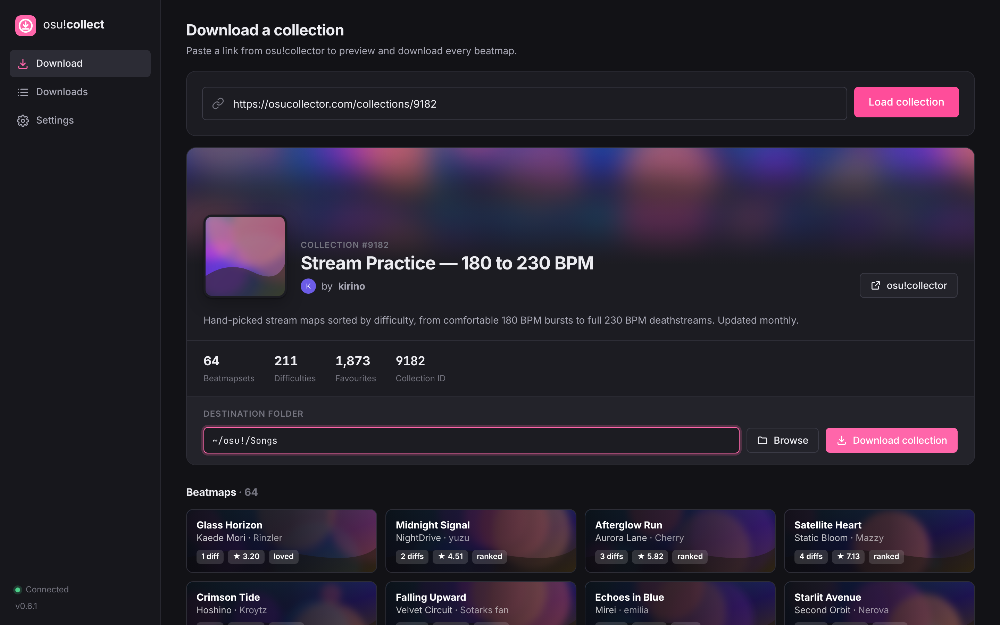
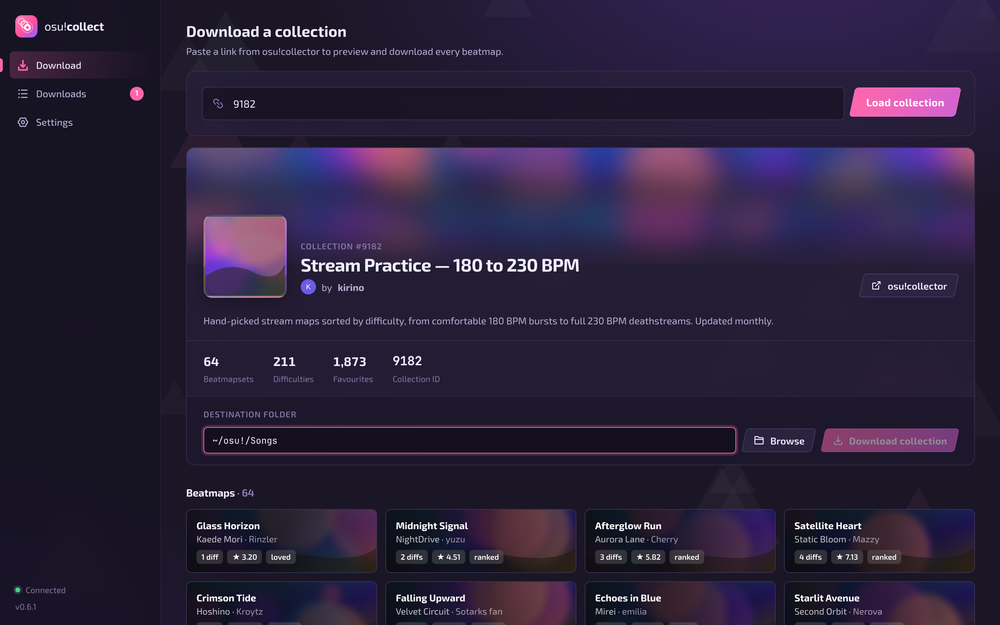
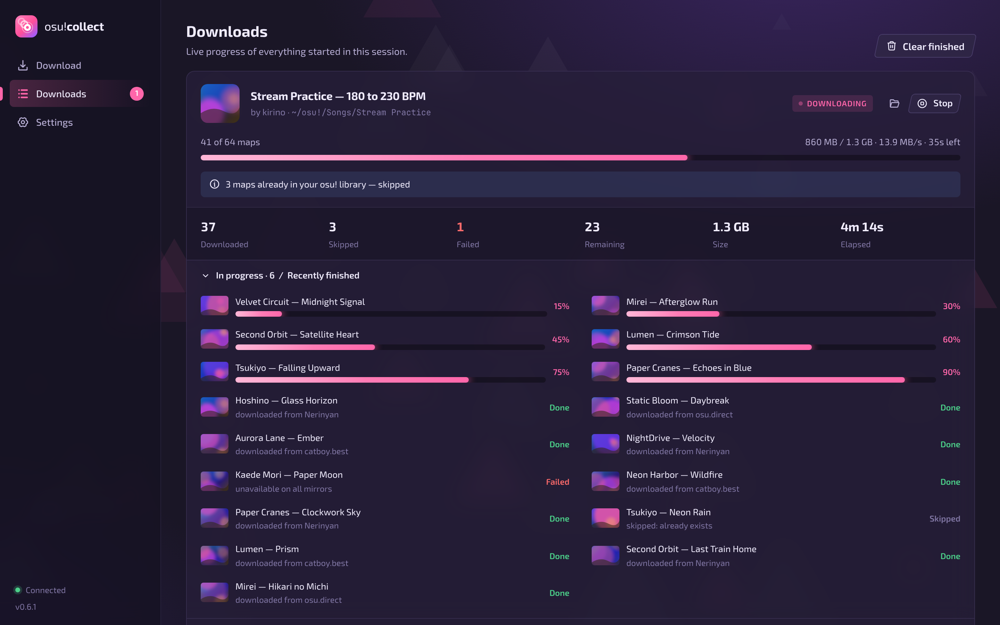
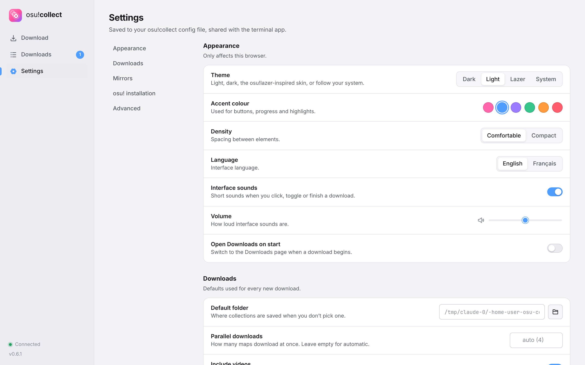
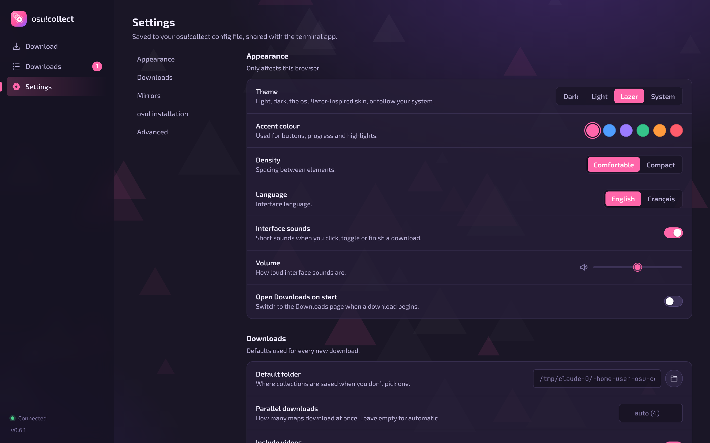

<div align="center">


# osu!collect

**Free osu!collector downloader, now with a web interface.**

[Web interface](#web-interface) · [Faster downloads](#faster-downloads) · [Features](#features) · [Getting started](#getting-started) · [Settings](#settings) · [Terminal app](#terminal-app)

</div>

osu!collect **downloads osu! beatmap collections from [osu!collector](https://osucollector.com)**. Paste a collection link, pick a folder, and every map downloads in parallel from several mirrors, switching mirrors automatically when one fails. You also get a ready-to-import `collection.db`, and you can update the collection later.

It runs locally in your browser (`osu-collect web`) or in your terminal (`osu-collect`). Both use the same download engine and the same config file.

<div align="center">



</div>

## Web interface

```bash
osu-collect web
```

This starts a small local server on `http://127.0.0.1:7270` and opens it in your default browser. Nothing is exposed to the network, and the page only works in the browser tab it opened. Press <kbd>Ctrl</kbd>+<kbd>C</kbd> in the terminal to stop it.

### 1. Paste a collection

Paste an osu!collector URL (`https://osucollector.com/collections/12345`) or just the ID. The collection loads right away: name, uploader, number of beatmapsets and difficulties, favourites, plus a grid of every map with its cover, artist, mapper, star rating and status.

<div align="center">


</div>

### 2. Choose where it goes

Type a path or click **Browse** to pick a folder with the built-in folder picker, which has shortcuts for Home, Downloads and your osu! `Songs` folder. The last folder you used is remembered.

### 3. Download and watch it live

Progress updates live in the **Downloads** page: overall progress, transfer speed, time left, total size, a progress bar for each map being downloaded, recently finished maps and the source mirror for each, and a list of failed maps with links to osu!. You can stop a download or open its folder from the card.

<div align="center">

</div>

### Lazer mode

A skin inspired by osu!lazer: deep purple translucent panels, slanted buttons, glowing progress bars, the Exo 2 font, and triangles slowly drifting up in the background. Pick **Lazer** under Settings → Appearance → Theme.

<div align="center">


</div>

### Themes, sounds and motion

- **Themes:** dark, light, Lazer or follow the system, six accent colours, comfortable or compact spacing, English or French. Saved in your browser and applied instantly.
- **Interface sounds:** short sounds when you click, flip a switch, open the folder picker, start a download or when one finishes or fails. They're generated in the browser (no audio files), and can be turned off or made quieter in Settings.
- **Animations:** page transitions, cards that appear one after another, a hit-burst ring on button presses, counting stats, a closing approach circle on the logo when you hover it, and toasts that slide in. All of it is turned off if your system asks for reduced motion.

<div align="center">


</div>

## Features

- **Free, no account needed.** The official osu!Collector app is paid.
- **Nine mirrors with automatic failover.** osu!collect keeps downloading even when some mirrors are rate-limiting you. Reorder or disable them, or add your own URL templates. See [Mirrors](https://github.com/uwuclxdy/osu-collect/wiki/Mirrors).
- **A real osu! collection, verified.** An integrity-checked `collection.db`, ready to import into osu! stable or lazer. See [Usage](https://github.com/uwuclxdy/osu-collect/wiki/Usage).
- **Skips maps you already have.** Maps already in your osu! library are detected and skipped, but they're still added to `collection.db`.
- **Keep collections up to date.** Check a downloaded collection again later and download only new or missing beatmaps (terminal app). See [Updating collections](https://github.com/uwuclxdy/osu-collect/wiki/Updating-Collections).
- **Search maps without a collection.** Filter by difficulty using the osu! API or nzbasic's community database (terminal app). See [Finding maps](https://github.com/uwuclxdy/osu-collect/wiki/Finding-Maps).

## Faster downloads

The download engine was reworked to get the most out of every mirror:

- **Mirrors are picked by measured speed.** Each mirror's real throughput is tracked during the run, and every new map goes to the fastest mirror that isn't already busy. The old engine always started with the first mirror in your list, even when it was the slowest.
- **Slow mirrors are dropped mid-transfer.** If a map is crawling (under ~160 KiB/s after 8 seconds and not about to finish) while another mirror is available, it restarts on a faster one. A mirror that sends nothing at all is caught within a second instead of after the 2-minute stall timeout.
- **Instant failover.** A mirror that errors is skipped for that map right away instead of being retried three times with back-off first. A dead keep-alive connection still gets one instant retry.
- **No blocking size probe.** When a mirror doesn't send the file size, the size lookup runs alongside the download instead of delaying its start.
- **Fewer, larger disk writes** (1 MiB write buffer), warm connection reuse, and `TCP_NODELAY`.
- **More parallel downloads by default:** twice your CPU core count, between 12 and 24, instead of one per core.

Measured offline with the included benchmark (three local fake mirrors at 300 KiB/s, 1.5 MiB/s and 4 MiB/s, slowest listed first, 40 maps of 2 MiB):

| Parallel downloads | Before | After | Speed-up |
| --- | --- | --- | --- |
| 8 | 29.9 s (2.7 MiB/s) | 10.3 s (7.8 MiB/s) | **2.9×** |
| 16 | 14.5 s (5.5 MiB/s) | 9.3 s (8.7 MiB/s) | **1.6×** |

Real-world gains depend on your connection and on how the mirrors behave that day. Run the benchmark yourself:

```bash
cargo run --release --manifest-path osu-downloader/Cargo.toml --example mirror_bench -- 8 40
```

## Getting started

### Download

Grab the latest version from the [Releases page](https://github.com/Underspace1/osu-collect/releases/latest):

- **Windows:** `osu-collect-setup-x64.exe` is a regular installer. It installs for your user only (no admin rights needed), adds **osu!collect** shortcuts to the Start menu and desktop that open the web interface, can add `osu-collect` to your `PATH`, and shows up in *Settings → Apps* so you can uninstall it. A portable `osu-collect-windows-x64.exe` is attached too.
- **Linux x64 / macOS Apple Silicon:** download the binary, make it executable (`chmod +x`) and run `./osu-collect-linux-x64 web` or `./osu-collect-macos-arm64 web`.

osu!collect updates itself from this repository's releases.

### Build from source

You need Rust 1.85+ (edition 2024), CMake, a C++17 compiler, and the OpenSSL and zlib development headers (on Debian/Ubuntu: `sudo apt install cmake build-essential libssl-dev zlib1g-dev`).

```bash
git clone --recursive https://github.com/Underspace1/osu-collect
```

```bash
cd osu-collect && cargo build --release
```

The binary is `target/release/osu-collect`. If you've already cloned without `--recursive`, run `git submodule update --init --recursive` first.

### Commands

| Command | What it does |
| --- | --- |
| `osu-collect web` | Opens the web interface in your browser |
| `osu-collect web --port 8080` | Uses another port (falls back to a random free port if it's taken) |
| `osu-collect web --no-open` | Starts the server without opening a browser |
| `osu-collect` | Opens the terminal interface |
| `osu-collect update-collections` | Checks your installed collections for missing maps, without opening an interface |

## Settings

<div align="center">

</div>

The **Settings** page writes to the same `config.toml` as the terminal app, so changes made in one show up in the other.

| Section | Options |
| --- | --- |
| Appearance | Theme (dark / light / Lazer / system), accent colour, spacing, language, interface sounds and volume, whether to switch to Downloads when a download starts |
| Downloads | Default folder, number of parallel downloads (automatic: 2 × CPU cores, 12 to 24), include videos, skip maps you already have |
| Mirrors | Enable or disable each mirror, change the order (drag or arrows), add custom mirrors (`https://example.com/d/{id}`) |
| osu! installation | stable or lazer, install folder (detected automatically) |
| Advanced | Requeue rate-limited maps and how long to wait first, archive validation level (off / standard / strict) |

The official osu! API mirror needs an osu! login, so it can only be set up in the terminal app.

## Terminal app

The original terminal interface is still there: run `osu-collect` with no arguments. It covers everything the web interface does, plus collection updates, map search and osu! login.

<div align="center">


</div>

## License

Licensed under either of [MIT](LICENSE-MIT) or [Apache-2.0](LICENSE-APACHE), at your option.

The web interface bundles a subset of [MingCute icons](https://www.mingcute.com) (Apache-2.0).

<sub>Beatmap covers and titles in the screenshots are placeholders generated for the documentation.</sub>
