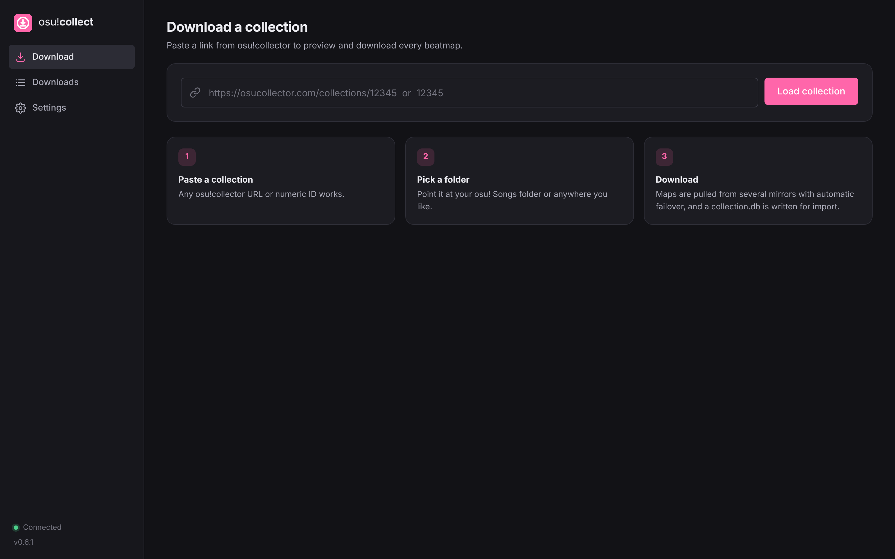
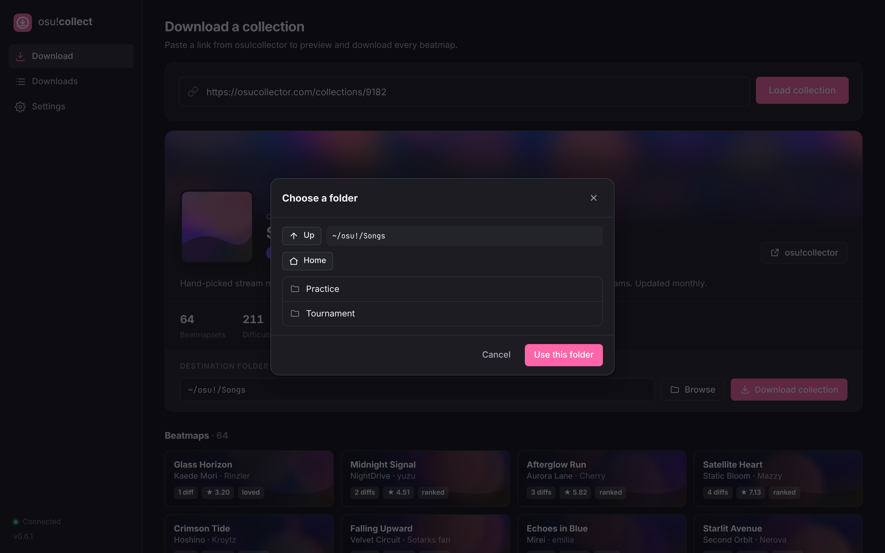
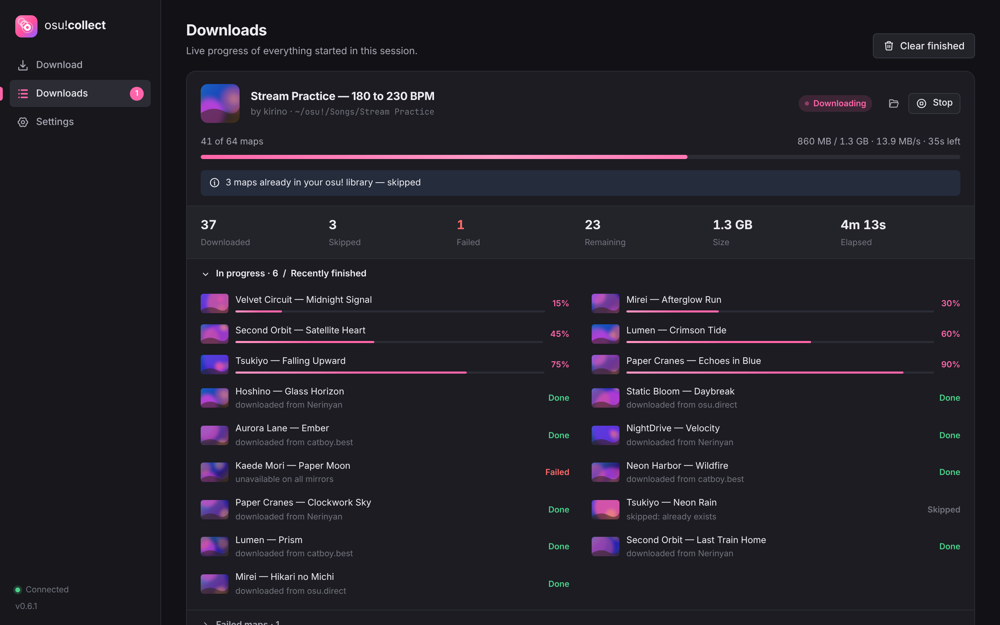
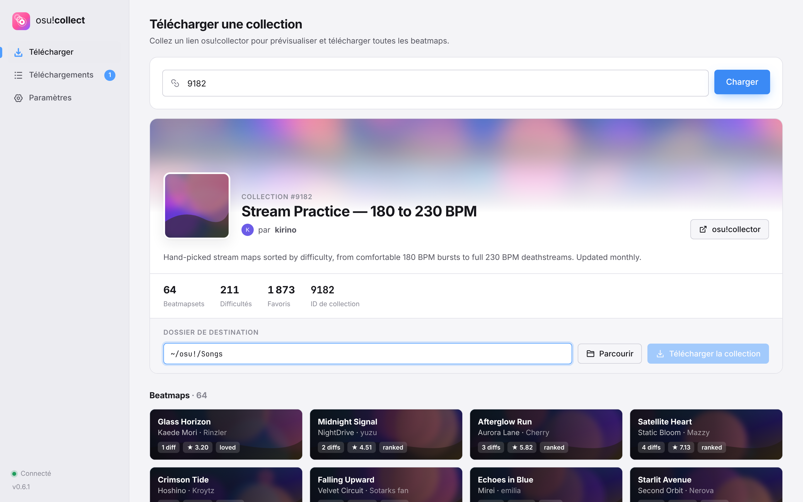
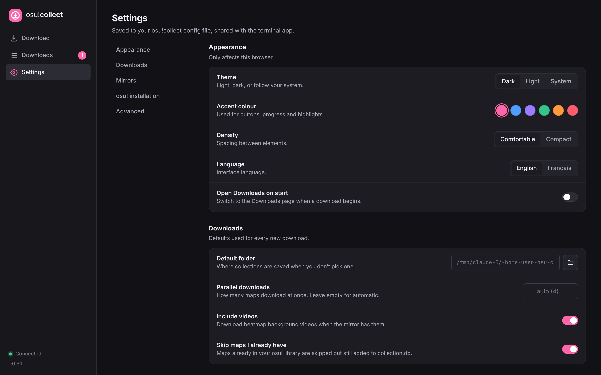
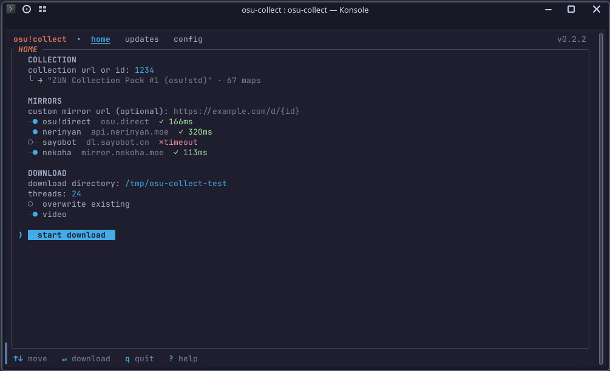
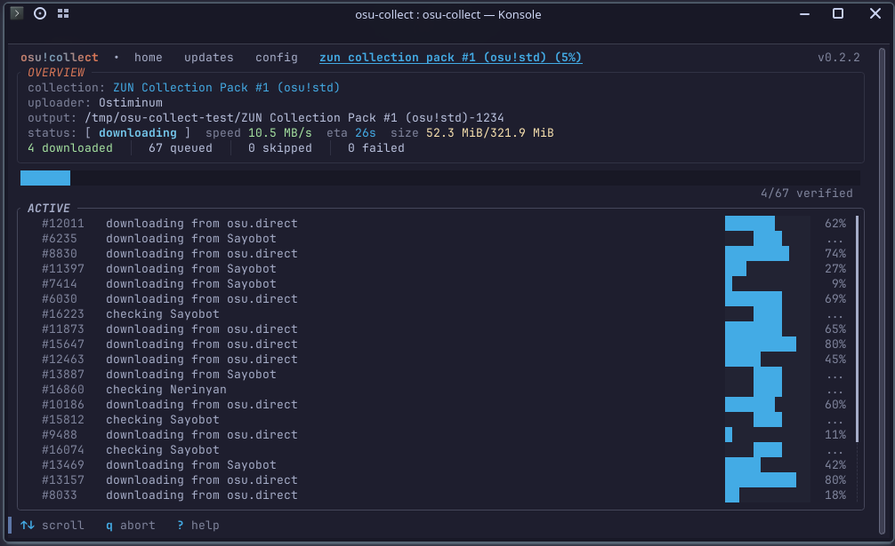

<div align="center">


# osu!collect

**Free osu!collector downloader, now with a web interface.**

[Web interface](#web-interface) · [Features](#features) · [Getting started](#getting-started) · [Settings](#settings) · [Terminal app](#terminal-app)

</div>

osu!collect **downloads osu! beatmap collections from [osu!collector](https://osucollector.com)**. Paste a collection link, pick a folder, and every map downloads in parallel from several mirrors, switching mirrors automatically when one fails. You also get a ready-to-import `collection.db`, and you can update the collection later.

It runs locally in your browser (`osu-collect web`) or in your terminal (`osu-collect`). Both use the same download engine and the same config file.

<div align="center">


</div>

## Web interface

```bash
osu-collect web
```

This starts a small local server on `http://127.0.0.1:7270` and opens it in your default browser. Nothing is exposed to the network, and the page only works in the browser tab it opened. Press <kbd>Ctrl</kbd>+<kbd>C</kbd> in the terminal to stop it.

### 1. Paste a collection

Paste an osu!collector URL (`https://osucollector.com/collections/12345`) or just the ID. The collection loads right away: name, uploader, number of beatmapsets and difficulties, favourites, plus a grid of every map with its cover, artist, mapper, star rating and status.

<div align="center">


</div>

### 2. Choose where it goes

Type a path or click **Browse** to pick a folder with the built-in folder picker, which has shortcuts for Home, Downloads and your osu! `Songs` folder. The last folder you used is remembered.

### 3. Download and watch it live

Progress updates live in the **Downloads** page: overall progress, transfer speed, time left, total size, a progress bar for each map being downloaded, recently finished maps and the source mirror for each, and a list of failed maps with links to osu!. You can stop a download or open its folder from the card.

<div align="center">

</div>

### Themes and languages

Dark, light or system theme, six accent colours, comfortable or compact spacing, and English or French. These are saved in your browser and apply instantly.

<div align="center">


</div>

## Features

- **Free, no account needed.** The official osu!Collector app is paid.
- **Nine mirrors with automatic failover.** osu!collect keeps downloading even when some mirrors are rate-limiting you. Reorder or disable them, or add your own URL templates. See [Mirrors](https://github.com/uwuclxdy/osu-collect/wiki/Mirrors).
- **A real osu! collection, verified.** An integrity-checked `collection.db`, ready to import into osu! stable or lazer. See [Usage](https://github.com/uwuclxdy/osu-collect/wiki/Usage).
- **Skips maps you already have.** Maps already in your osu! library are detected and skipped, but they're still added to `collection.db`.
- **Keep collections up to date.** Check a downloaded collection again later and download only new or missing beatmaps (terminal app). See [Updating collections](https://github.com/uwuclxdy/osu-collect/wiki/Updating-Collections).
- **Search maps without a collection.** Filter by difficulty using the osu! API or nzbasic's community database (terminal app). See [Finding maps](https://github.com/uwuclxdy/osu-collect/wiki/Finding-Maps).

## Getting started

### Build from source

You need Rust 1.85+ (edition 2024), CMake, a C++17 compiler, and the OpenSSL and zlib development headers (on Debian/Ubuntu: `sudo apt install cmake build-essential libssl-dev zlib1g-dev`).

```bash
git clone --recursive https://github.com/Underspace1/osu-collect
```

```bash
cd osu-collect && cargo build --release
```

The binary is `target/release/osu-collect`. If you've already cloned without `--recursive`, run `git submodule update --init --recursive` first.

### Commands

| Command | What it does |
| --- | --- |
| `osu-collect web` | Opens the web interface in your browser |
| `osu-collect web --port 8080` | Uses another port (falls back to a random free port if it's taken) |
| `osu-collect web --no-open` | Starts the server without opening a browser |
| `osu-collect` | Opens the terminal interface |
| `osu-collect update-collections` | Checks your installed collections for missing maps, without opening an interface |

## Settings

<div align="center">

</div>

The **Settings** page writes to the same `config.toml` as the terminal app, so changes made in one show up in the other.

| Section | Options |
| --- | --- |
| Appearance | Theme, accent colour, spacing, language, whether to switch to Downloads when a download starts |
| Downloads | Default folder, number of parallel downloads (automatic by default), include videos, skip maps you already have |
| Mirrors | Enable or disable each mirror, change the order (drag or arrows), add custom mirrors (`https://example.com/d/{id}`) |
| osu! installation | stable or lazer, install folder (detected automatically) |
| Advanced | Requeue rate-limited maps and how long to wait first, archive validation level (off / standard / strict) |

The official osu! API mirror needs an osu! login, so it can only be set up in the terminal app.

## Terminal app

The original terminal interface is still there: run `osu-collect` with no arguments. It covers everything the web interface does, plus collection updates, map search and osu! login.

<div align="center">


</div>

## License

Licensed under either of [MIT](LICENSE-MIT) or [Apache-2.0](LICENSE-APACHE), at your option.

<sub>Beatmap covers and titles in the screenshots are placeholders generated for the documentation.</sub>
